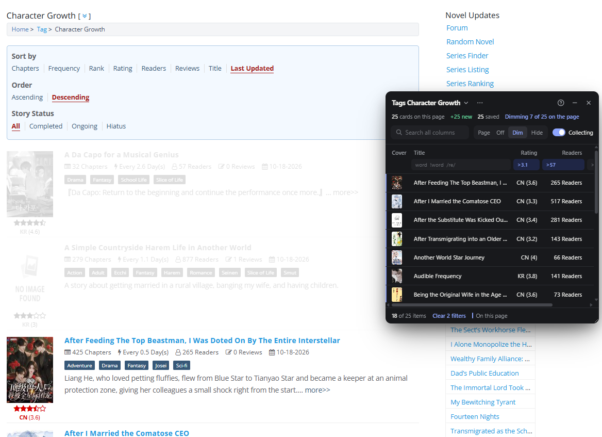
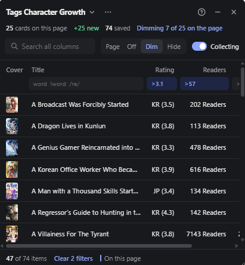
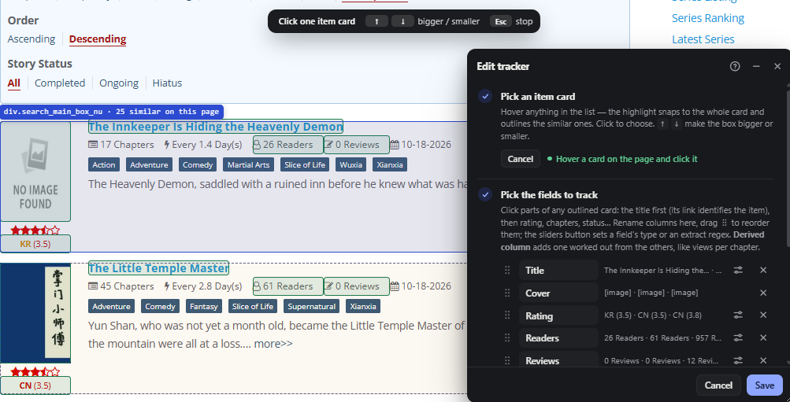

# Page Sieve

Not enough filters when searching? Try Page Sieve.

Created this extension because I wanted to search novels in a more granular way (i.e., by ratings + readers, or by a derived calculated field)...

<table>
  <tr>
    <td></td>
    <td></td>
  </tr>
</table>

## What it does

Page Sieve turns any paginated catalog (web novels, manga, books, games, products) into one list you can
sort and filter. You choose which details to track by pointing at them on the page. There's no code or
selectors to write, and it takes under a minute per site.

- **Sort and filter across every page you've visited,** not just the 20 titles in front of you.
- **Filter on any detail,** like `completed`, `>100` chapters, rated `>4.5`, updated `<30d`.
- **Make up your own columns,** like views per chapter or days since the last update.
- **Apply your filters to the site itself,** dimming or hiding the cards that don't match.
- **Pull in details the site doesn't show,** read from the data the page already loaded.
- **Everything stays in your browser.** No server, no account, no analytics.

## The problem

Catalog and search pages show maybe 20 titles at a time, spread over dozens of pages, and their own
sorting and filtering is usually limited. You can often sort by "latest" or "popular", but not by
rating *and* chapter count. You can't hide titles you've already ruled out, and you can't filter on
whatever detail matters to you, like "completed, over 100 chapters, rated above 4.5, updated this month".

So people end up paging through the catalog with the details in their head or in a scratch
spreadsheet: open page 1, note the promising titles, open page 2, try to remember how they compared
to page 1. Every site lays its cards out differently, and general-purpose scraping tools are built
for exporting data, not for browsing.

## Install (Chrome / Edge / Brave)

1. Open `chrome://extensions` (Edge: `edge://extensions`).
2. Turn on **Developer mode**.
3. Click **Load unpacked** and choose this project folder (the one containing `manifest.json`).
4. Pin the icon if you like. Shortcut: **Alt+Shift+T** (change it at `chrome://extensions/shortcuts`).

Tabs that were already open before installing still work: clicking the icon injects the scripts.

## Quick start

1. On a catalog / search / browse page, click the icon → **New tracker**.
2. **Pick the card.** Hover anything in the list. The highlight snaps to the whole card it belongs to
   and outlines the similar cards. Use `↑`/`↓` to make the box bigger or smaller, then click.
3. **Pick fields.** Click the parts of any outlined card you want as columns: title first (its link
   identifies the item), then rating, chapters, views, status, cover image… Rename columns if the
   guessed name is wrong, and drag a field by its handle (or focus the handle and press `↑`/`↓`) to
   change the column order. Click **Done picking**.
4. **Save.** "Collect on pages matching" decides where it collects: `*` = one path part,
   `/**` at the end = that page and everything below, `/**` alone = the whole site.
5. **Browse.** Items from each page are added (no duplicates, keyed by link). Infinite-scroll pages
   are followed as they load. Rows from the current page have an accent bar on the left.

In the list: click a column header to sort (numbers/dates high→low first, then low→high, then
off; blank values always last), click the tracker name to switch trackers (each shows its item count
and whether it collects on this page), click a row to open it, `×` to remove (it won't come back). `⋯` has
Edit, Export CSV/JSON (exports what the filters show), Clear list and Delete tracker. `–`
minimizes it to a small badge you can drag anywhere (click it to expand). The panel can be dragged
by its header and resized from the corner.

**The `?` button in the panel opens the full built-in guide**, with clickable examples.

Values are read by meaning, not as plain text: `★ 4.6`, `Ch. 213`, `1.2M views` and
`Updated 3 days ago` all sort as numbers or dates.

## Filters

Every column has a filter box under its header; the box at the top searches all columns. Filters
are saved per tracker.

| Column type | Examples |
|---|---|
| Number (cells containing a number) | `>4.5` `<=100` `10..50` `100..` `..50` `213` `!=0` `>=1.2M` |
| Date (`3 days ago`, `Oct 12, 2025`) | `<7d` (newer than 7 days) `>3m` (older than 3 months) `1d..2w` `>2025-01-01` |
| Text | `dragon` (contains) `!hiatus` (doesn't) `"dragon chef"` (phrase) `="Ongoing"` (exactly) |
| Any | `/regex/i` `!/regex/` `empty` `!empty` |

Space = AND, ` | ` = OR (`Ongoing | Hiatus`). An incomplete regex turns the box red and hides nothing.

**Filter the page itself:** the **Page** switch next to the search box (Off / Dim / Hide) applies the
same filters to the site's own cards: Dim fades the ones that don't match, Hide removes them from
view. Items removed with × count as not matching. Works on infinite-scroll pages and while
Collecting is paused. Clear the filters, set Page to Off, or close the panel to restore the page.

## Derived columns

A derived column is worked out from other columns instead of picked from the page. In ⋯ → Edit this
tracker, click **Derived column** and write a formula (click a column name under the box to insert it).
It starts as `{A} / {B}` from the first two number columns.

| Formula | Gives |
|---|---|
| `{Views} / {Chapters}` | views per chapter |
| `{Follows} / {Views} * 100` | follows as a percentage of views |
| `today - {Updated}` | days since the last update (date columns count in days) |
| `{Updated} - {Started}` | days between two dates |

`+ - * /` and parentheses work. Column names go in `{ }` (case doesn't matter). A cell is blank when a
column it uses is blank or has no number, or when dividing by 0. Derived columns sort and filter like
number columns, can use any picked column and the derived columns above them, and follow renames made in
the editor.

<!-- IMAGE: a derived column in the editor and in the list -->

## Page data

Many sites load more than they show: a table might list a title and a cost while the data behind it also
has start dates, funding source or coordinates, and the rest only appears when you click a row. Page
Sieve can read that data directly, with no clicking.

In ⋯ → Edit this tracker, click **Page data**. It lists the fields the site loaded for the cards on the
page, with values from the first card. Click a field to add it as a column. Each card is matched to its
record automatically, by an id that appears in the card (like a contract number or the id in its link);
the box says which one and how many cards matched. Page data columns have the usual Type and Extract
settings, and derived columns can use them.

It works on sites that load their lists as data (`fetch` / `XMLHttpRequest` returning JSON), which most
modern sites do. It only reads responses the site already received; it never sends requests of its own.
If the box says no data was seen, reload the page or go to the next page so the site loads its list again.

## Field settings

In ⋯ → Edit this tracker, the settings button (sliders) next to a field sets:

- **Type**: Auto, Number (shows just the number: `Ch. 213` → `213`), Text, or Date.
- **Extract**: a regex that keeps only part of the text: the first `( group )`, or the whole match.
  `Ch\.\s*(\d+)` keeps `45` from `Vol. 3 Ch. 45`. No match = blank cell.

Sample values update live as you type. Settings also apply to items already collected (the original
text is stored; numbers and dates are worked out when the list is shown).

## Limits

- Text drawn inside images or a `<canvas>` can't be read, and neither can content inside iframes.
- If a site completely changes its layout, the tracker finds 0 cards. The status line says so;
  use ⋯ → Edit → Re-pick card.
- It only sees pages you actually open. It doesn't crawl or fetch pages in the background.
- Page data only covers what the site loads as JSON. Details fetched only when you open an item
  aren't there until you open it.

## Privacy

Everything stays in your browser's extension storage on this computer. Page data is read from
responses the site already sent to your browser, inside the page; nothing is copied anywhere else.
The extension has no server, no accounts and no analytics, and it doesn't sync. The only network
traffic is cover thumbnails in the list, which load from the site you picked them on, just as they do
on the page. Use Export CSV/JSON to keep a copy.

## Development

### Files

- `content/picker.js`: hover/click picker overlay
- `content/selectors.js`: builds selectors that survive page changes (skips hashed class names)
- `content/values.js`: turns text into sortable numbers/dates; per-field type + extract regex
- `content/formula.js`: derived-column formulas (`{Views} / {Chapters}`)
- `content/extract.js`: reads a card's fields; guesses column names
- `content/netwatch.js`: runs in the page's own context and passes the JSON the site loads to the extension
- `content/pagedata.js`: keeps those records and matches each card to its record (page data fields)
- `content/filters.js`: the column filter syntax
- `content/pagefilter.js`: hides/dims the site's cards that don't match
- `content/help.js`: the built-in guide (`?` button)
- `content/store.js`: `chrome.storage.local` wrapper
- `content/panel.js`: the floating panel (shadow DOM)
- `content/main.js`: collects on page load / DOM changes / client-side navigation
- `background.js`: toolbar icon + shortcut
- `icons/`: `icon.svg` (48/128 px) and `icon-small.svg` (16 px) are the logo sources;
  `python icons/render.py` regenerates the PNGs

### Testing

Run `python test/serve.py` (serves this folder on port 8766 with caching off) and open:

- `http://localhost:8766/test/unit.html`: unit tests for parsing, selectors, filters and derived-column formulas
- `http://localhost:8766/test/fixtures/catalog.html`: fake paged catalog that loads the real content
  scripts through a `chrome.*` shim (`test/harness.js`). Use the "Toggle panel" button in the top bar.
- `http://localhost:8766/test/fixtures/infinite.html`: infinite-scroll version
- `http://localhost:8766/test/fixtures/api.html`: a table drawn from JSON that has more fields than it
  shows, for page data ("Load page 2" fetches more without reloading)
